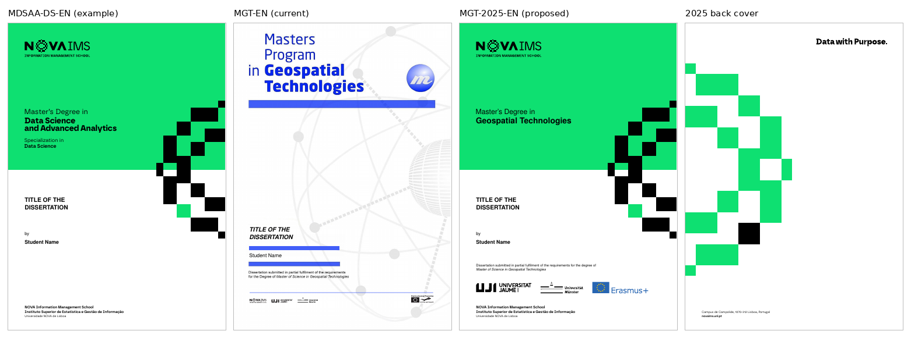

# NOVA IMS Thesis Template (lean, Overleaf-ready)

A LaTeX thesis template for **NOVA Information Management School (NOVA IMS)**, Universidade NOVA de Lisboa.
It keeps the NOVA IMS layout of the [NOVA IMS thesis template 2025](https://github.com/pdecampossouza/nova-ims-thesis-template-2025) (official covers, title page, statement of integrity, copyright page, margins, headings) but runs on a small set of standard packages, so it compiles on a **free Overleaf account**.

> **Status:** unofficial proposal, maintained in a fork. The official template is the upstream repository above. Check with your programme office before submitting with this version.

## Preview

[](preview/template-preview.pdf)

See the full compiled template in [preview/template-preview.pdf](preview/template-preview.pdf) (example settings, placeholder text). The `preview` folder is only for viewing on GitHub; it is not needed to compile, and you can delete it in your own project.

## Why this version

| | Upstream template (NOVAthesis) | This template |
| --- | --- | --- |
| Full build from scratch | about 27 s | about 5 s |
| Recompile after an edit | several seconds | about 1 s |
| Free Overleaf (10 s limit) | times out | compiles |
| Schools included | all NOVAthesis schools | NOVA IMS only |
| Upload to Overleaf | unzip the inner zip first | upload as it is |

## Quick start on Overleaf

1. Download this repository as a zip (Code, Download ZIP).
2. In Overleaf: New Project, Upload Project, choose the zip.
3. Open `thesis-info.tex` and fill in your title, name, student number, programme, supervisors and cover code.
4. Press Recompile. The main document is `main.tex`, the compiler is pdfLaTeX (the Overleaf default).

## Choose your cover

Set the cover in `thesis-info.tex` with `\covercode{...}`, using a folder name from `Figures/Covers`. All covers are the official NOVA IMS artwork (English versions).

| Code | Programme | Specialization |
| --- | --- | --- |
| `DGI-EN` | Doctoral Program in Information Management | |
| `MCSIG-CDG-EN` | Geographic Information Systems and Science | Geospatial Data Science |
| `MCSIG-CSIG-EN` | Geographic Information Systems and Science | Geographic Information Systems and Science |
| `MDDM-DMA-EN` | Data-Driven Marketing | Digital Marketing & Analytics |
| `MDDM-DS4M-EN` | Data-Driven Marketing | Data Science for Marketing |
| `MDDM-MI-EN` | Data-Driven Marketing | Marketing Intelligence |
| `MDDM-MRCRM-EN` | Data-Driven Marketing | Marketing Research & CRM |
| `MDSAA-BA-EN` | Data Science and Advanced Analytics | Business Analytics |
| `MDSAA-DS-EN` | Data Science and Advanced Analytics | Data Science |
| `MEGI-AGI-EN` | Statistics and Information Management | Data Analytics |
| `MEGI-AGR-EN` | Statistics and Information Management | Risk Analysis and Management |
| `MEGI-MRCRM-EN` | Statistics and Information Management | Marketing Research and CRM |
| `MGI-BI-EN` | Information Management | Business Intelligence |
| `MGI-GCBI-EN` | Information Management | Knowledge Management and Business Intelligence |
| `MGI-GSI-EN` | Information Management | Information Systems Management |
| `MGI-GSTI-EN` | Information Management | Information Systems and Technologies Management |
| `MGI-MI-EN` | Information Management | Marketing Intelligence |
| `MGI-TD-EN` | Information Management | Digital Transformation |
| `MGT-EN` | Geospatial Technologies (Erasmus Mundus), current official cover | |
| `MGT-2025-EN` | Geospatial Technologies, **proposed** cover in the 2025 NOVA IMS identity | |

Also set the matching text for the title page, for example:

```latex
\covercode{MDSAA-DS-EN}
\programme{Data Science and Advanced Analytics, with a specialization in Data Science}
\degreetype{msc}   % or phd for the Doctoral Program
```

The back cover follows the cover code: programmes with their own back cover use it, all others use the official 2025 NOVA IMS back cover (`Figures/Covers/back-2025.pdf`).

### Geospatial Technologies: current and proposed cover

Every NOVA IMS programme in the upstream template already has a cover in the identity NOVA IMS introduced in 2025, except Geospatial Technologies, which keeps the earlier Erasmus Mundus design. This template offers both:

- `\covercode{MGT-EN}`: the current official cover artwork and back cover, unchanged. The title is set in bold italic capitals and the author's name sits between two blue bars.
- `\covercode{MGT-2025-EN}`: a proposal in the 2025 identity. It uses the official vector 2025 cover with the other programme's text removed, typesets "Master's Degree in Geospatial Technologies", adds a row of partner logos, and uses the official 2025 back cover.

The partner logos of the programme (Universitat Jaume I, Universität Münster, Erasmus+) are included in `Figures/Logos`. Switch them on together with the cover:

```latex
\covercode{MGT-2025-EN}
\programme{Geospatial Technologies}
\partnerlogos{Logos/uji,Logos/uni-muenster,Logos/erasmus-plus}
\partnerlogoscale{Logos/uji}{0.8}
```

All logos share one height and are centred in the row. `\partnerlogoscale` resizes a single logo so that the logos look equally prominent (1 = full height).

A missing logo file shows as a labelled empty box, so the document still compiles.

## Project structure

| Path | Purpose |
| --- | --- |
| `main.tex` | Main document and order of all parts. |
| `thesis-info.tex` | Title, author, student number, programme, supervisors, date, keywords, SDGs, cover. |
| `novaims-thesis.cls` | Layout: covers, title page, statement of integrity, Use of Generative AI table, copyright page, headings, margins, references. |
| `FrontMatter/` | Use of Generative AI table, dedication, acknowledgements, Abstract, Resumo, acronyms. |
| `Chapters/` | Chapters 1 to 6 (examples of citations and tables in Chapter 2). |
| `BackMatter/` | Declaration of Generative AI Use. |
| `Appendices/` | Appendix A. Copy the file for more appendices. |
| `Bibliography/` | `references.bib` and optional citation key aliases. |
| `Figures/` | Your figures, official covers, partner logos (Geospatial Technologies), SDG icons. |
| `preview/` | Compiled example PDF and cover overview for this README (not needed to compile). |

## Settings

- **Font:** Arial/Helvetica 12 pt, as set in the NOVA IMS template. For 12 pt Times write `\documentclass[times]{novaims-thesis}`.
- **Page layout:** A4, margins 3 cm (top, bottom) and 3.25 cm (left, right), line spacing 1.15, as in the NOVA IMS template.
- **Citations:** `\citet{key}` gives Author (Year), `\citep{key}` gives (Author, Year). References are in APA author-year style (apacite), with "et al." from the first citation and DOIs as links.
- **Sustainable Development Goals:** `\sdgs{4,9}` prints the SDG icons under the abstract. `\sdgs{}` hides them.
- **Front matter:** after the cover, title page and copyright page come the Statement of Integrity (with space for a signature), Use of Generative Artificial Intelligence, Dedication, Acknowledgements, Abstract, Resumo, Index, Index of Tables, Index of Figures and the acronyms. The front matter pages are listed in the Index with roman page numbers.
- **Optional pages:** `\genaiusepage{false}` and `\dedicationpage{false}` in `thesis-info.tex` remove the Use of Generative AI table and the dedication. Fill the table in `FrontMatter/genai-use.tex` with one `\genairow{Task}{yes|no}{Tool}` line per task.
- **Supervisors and date:** one centred block per supervisor on the title page, `\supervisor{Name, PhD}{School\\University\\City, Country}` (and `\cosupervisor` in the same way). `\submissiondate[Day]{Month}{Year}` prints the full date; the day is optional.
- **Compile part of the thesis:** use the `\includeonly` line at the top of `main.tex`.
- **Engines:** pdfLaTeX (default), XeLaTeX and LuaLaTeX all work. Locally: `latexmk -pdf main.tex`.

## Differences from the upstream template and known limitations

- Only NOVA IMS. The files and code for other NOVAthesis schools are not included.
- English only. The fixed texts (title page, statement of integrity, copyright) are in English, and only the English covers are included. A Resumo in Portuguese is part of the front matter.
- The official covers use the Borna typeface, which is not included. Text typeset on the covers (title, author, and the programme name on `MGT-2025-EN`) uses Helvetica.
- The reference style is apacite (based on APA 6) with "et al." set to the APA 7 rule. Full APA 7 with biblatex would make each compile too slow for a free Overleaf account.

## Credits and licence

The layout, front-matter wording and cover artwork come from the NOVA IMS thesis template 2025 by Paulo Vitor de Campos Souza (github.com/pdecampossouza/nova-ims-thesis-template-2025), which adapts the NOVAthesis template by João Lourenço (github.com/joaomlourenco/novathesis). This derived version is distributed under the LaTeX Project Public License 1.3c (see `LICENSE`). Cover artwork and logos remain the property of NOVA IMS and the partner institutions.
